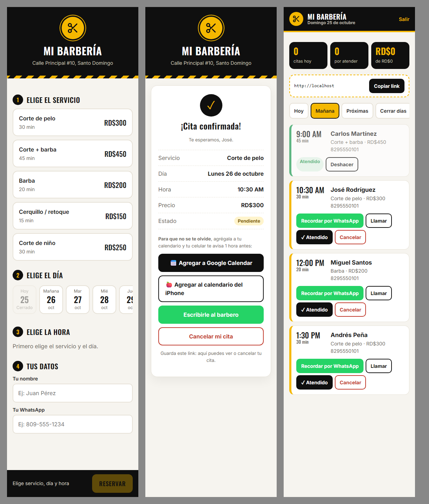

# ✂️ Barbería Citas

Sistema web de **reservas para barberías**: el cliente elige servicio, día y hora desde el celular,
n
y el barbero gestiona su agenda desde un panel privado. Sin mensualidades: Python + Flask + SQLite.

## Funciones
- **Clientes:** reservan sin crear cuenta, ven solo las horas libres según el horario y la duración del servicio.
- **Barbero:** panel con clave para ver, confirmar o cancelar citas del día y de la semana.
- **WhatsApp:** botones para confirmar la cita por WhatsApp con el mensaje ya escrito.
- **Configurable:** nombre, servicios, precios, duración y horario en `config.py`.
- **Modo prueba:** `PROBAR.bat` abre una base de datos de ejemplo que empieza limpia cada vez.

## Tecnologías
Python · Flask · SQLite · HTML/CSS (Jinja2) · diseño pensado primero para el celular

## Probarlo
```bash
pip install -r requirements.txt
python app.py
```
- Clientes: http://localhost:5000
- Panel del barbero: http://localhost:5000/panel (clave de prueba: `barbero123`)

En producción, define la variable de entorno `BARBERIA_SECRETO` y cambia la clave del panel.

## Lo que aprendí
- Rutas, plantillas y sesiones en **Flask**
- Diseñar tablas en **SQLite** y evitar citas que se crucen
- Guardar contraseñas con *hash* (`werkzeug.security`), nunca en texto plano
